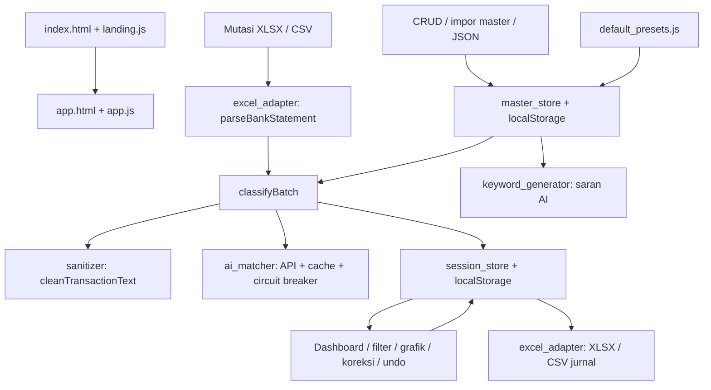

# Audit ZISWAFier Lite — 27 September 2026

## Kesimpulan

Repo ini cukup jelas sebagai demo klasifikasi mutasi berbasis browser, tetapi hasilnya belum aman dijadikan jurnal final tanpa pemeriksaan. Risiko terbesar berada pada integritas tanggal/nominal, identitas transaksi saat merge, konsistensi COA, kehilangan sesi ketika impor gagal, dan escaping HTML.

Audit dilakukan pada working tree dengan HEAD `824a34b`, Node `v25.0.0`, dan browser lokal. Tidak ada perubahan pada kode aplikasi, preset, maupun tes bawaan. Dua berkas untracked yang sudah ada sebelum audit, `filter-branch.cmd` dan `filter.sh`, tidak dijalankan atau diubah.

Tingkat bukti:

- **R**: direproduksi dengan modul aplikasi dan data sintetis dalam `docs/audit-repro.mjs`.
- **D**: terlihat pada empat input nyata dalam `test_data/test/`, melalui `docs/audit-datasets.mjs`.
- **B**: direproduksi lewat antarmuka browser lokal.
- **S**: jalur penyebab terlihat dalam kode; belum direproduksi secara end-to-end.

P1 berarti prioritas tinggi karena potensi kehilangan data, salah jurnal, atau keamanan. P2 berarti fungsi salah/parsial yang perlu diperbaiki. P3 berarti pemeliharaan, dokumentasi, atau pengalaman pengguna. Ini bukan klaim bahwa seluruh kemungkinan bug telah ditemukan.

## Verifikasi dan data

| Pemeriksaan | Hasil |
|---|---|
| `node test/run_tests.js` | 33 lulus, 0 gagal; parity dilewati karena `sample/inputt.xlsx` dan `sample/output.xlsx` tidak tersedia |
| `node docs/audit-repro.mjs` | 22 pemeriksaan perilaku yang diharapkan gagal; beberapa menguji akibat dari akar masalah yang sama |
| `node docs/audit-datasets.mjs` | 3.999 baris diparsing dan diklasifikasi dengan AI OFF; statistik di bawah |
| Browser: impor satu CSV sintetis | Tanggal 2026-09-01 tampil 2026-08-31; atribut HTML tambahan dari label masuk ke DOM |
| Browser: timpa dengan CSV invalid | Toast gagal impor muncul; dashboard kemudian kosong, sesi sebelumnya hilang |
| `node test/fix_config_v2.mjs` | Gagal pada baris pertama: `require is not defined in ES module scope`; tidak mencapai penulisan file |

Input yang ditemukan adalah `test_data/test/Input 1.xlsx` hingga `Input 4.xlsx`, bukan direktori literal `test_data/input`. Konfigurasi `test_data/ziswaf-config.json` ditemukan setelah audit awal: JSON tersebut valid dan memuat 21 COA, 16 program, 40 donatur, serta pengaturan Gemini. API key di dalamnya sudah berupa placeholder `REDACTED`, sehingga koneksi lama tidak dapat diuji. Pengukuran dataset dalam audit ini tetap memakai preset bawaan repo agar hasil awal dapat direproduksi. Config lokal hanya akan menjadi referensi struktur dan aturan; identitas khusus akan dianonimkan sebelum menjadi template publik.

| Berkas | Baris | Tanggal berbeda dari sumber | Unauthorized | COA tidak ada di master | Duplikasi tuple tanggal/label/nominal |
|---|---:|---:|---:|---:|---:|
| Input 1 | 999 | 999 | 716 | 5 | 0 |
| Input 2 | 1.000 | 1.000 | 671 | 5 | 8 |
| Input 3 | 1.000 | 1.000 | 705 | 6 | 2 |
| Input 4 | 1.000 | 1.000 | 305 | 6 | 385 |
| Total | 3.999 | 3.999 | 2.397 | 22 | 395 |

Jumlah nominal numerik dan jumlah baris tetap sama dengan sumber pada empat file tersebut. Hasil klasifikasi batch identik pada dua pengulangan penuh. Single dan batch juga sama untuk seluruh baris dataset ini; perbedaannya baru muncul pada kasus sintetis tertentu. Waktu klasifikasi batch sekitar 0,6–0,9 detik per 1.000 baris di Node lokal, bukan benchmark rendering browser.

Saat empat file digabung berurutan, seluruh 3.999 baris tersimpan tetapi hanya ada 1.000 ID unik. Duplikasi tuple tidak otomatis berarti transaksi bank duplikat: tanpa referensi transaksi, dua transfer sah dapat mempunyai tanggal, keterangan, dan nominal sama.

`test_data/output_formaat.xlsx` berisi 12.234 baris data dengan format lima kolom jurnal. Sebagai pembanding kandidat, pencocokan tanggal sumber + keterangan + nominal, dengan jumlah kemunculan diperhitungkan dan header dirapikan, hanya menemukan **18 baris sebanding**, 11 dengan COA sama. Sebanyak 3.981 input tidak mempunyai pasangan. Karena cakupan sangat kecil dan asal/otoritas output belum dipastikan, angka tersebut **bukan ukuran akurasi sistem**. Pembandingan memakai tanggal asli sumber supaya bug tanggal tidak menyamarkan perbedaan klasifikasi.

## Peta sistem



| Area / file | Tanggung jawab dan hubungan |
|---|---|
| `index.html` | Landing, metadata SEO, FAQ terstruktur, perbandingan Lite/Enterprise, form kontak, navigasi aplikasi |
| `js/landing.js` | Tema, menu mobile, animasi saat scroll, toggle edisi, pembukaan mailto; tidak mengirim email sendiri |
| `app.html` | DOM SPA, tiga langkah Konfigurasi/Upload/Dashboard, modal, kontrol AI, pustaka global |
| `js/app.js` | Hampir 3.000 baris pengendali UI: CRUD, dropdown, impor, progres, filter, Chart.js, seleksi, koreksi COA, undo, rescan, ekspor, scrollbar |
| `js/engine/sanitizer.js` | Normalisasi ejaan, ekstraksi nama dari beberapa pola bank, penghapusan alias/noise, sanitasi form |
| `js/engine/classifier.js` | Implementasi single dan batch; dua salinan besar logika deterministik; batch dilanjutkan micro-batch AI |
| `js/engine/ai_matcher.js` | Prompt program/donatur, API Gemini/Ollama/OpenAI-compatible, timeout, parser JSON, cache label, circuit breaker |
| `js/engine/keyword_generator.js` | Analisis keyword melalui AI, varian lokal, validasi hasil, metadata rekomendasi |
| `js/services/excel_adapter.js` | Baca sheet pertama, tebak header dalam 15 baris pertama, normalisasi nominal/tanggal, buat jurnal XLSX/CSV |
| `js/store/master_store.js` | Default master, CRUD, impor Excel per entitas, backup/restore JSON, akun sistem, persistensi dan subscriber |
| `js/store/session_store.js` | Baris transaksi, merge/dedupe, update/delete/restore, filter periode/kategori/pencarian, sort, halaman 80 baris |
| `js/config/default_presets.js` | 23 COA generik, 20 program, 4 donatur dummy, 2 alias contoh, AI OFF, schema v2 |
| `css/style.css` | Token tema gelap/terang, layout aplikasi, dropdown, responsivitas, grafik dan tabel |
| `css/components.css` | Komponen tombol, form, tabel, modal, badge, toast |
| `css/landing.css` | Layout marketing, kartu edisi, animasi, breakpoint landing |
| `js/vendor/xlsx.full.min.js` | SheetJS vendored; dipakai sebagai global `XLSX` di browser, melalui `createRequire` di tes |
| `serve.mjs` | HTTP server tanpa dependensi, clean URL lokal, port 5174 dengan retry |
| `vercel.json` | Rewrite/redirect clean URL, security headers, caching aset |
| `.github/workflows/deploy.yml` | Checkout → Node 20 → unit test → upload seluruh root → GitHub Pages |
| `.gitignore`, `.nojekyll` | Pengecualian file lokal/data privat dan pengaturan Pages |
| `site.webmanifest`, `robots.txt`, `sitemap.xml` | Metadata pemasangan dan SEO; tidak ada service worker/offline cache |
| SVG/PNG dan `docs/*.svg` | Logo, favicon, preview sosial, diagram alur/pipeline |
| `test/` | Campuran runner tes, analisis dataset, eksperimen AI, dan skrip yang mengubah konfigurasi |

### Model data dan penyimpanan

`master` memiliki `coaList`, `programs`, `donors`, `companyAliases`, dan `settings`. Relasi yang diharapkan: `program.coaCode → coa.code`, `program.parentCoaCode → coa.code`, `donor.defaultProgramId → program.id`, dan akun sistem → COA. Banyak jalur belum menegakkan relasi ini.

Parser menghasilkan `id/rawDate/rawLabel/rawAmount/partner`. Classifier menambah `transactionDate`, `cleanedLabel`, `extractedSenderName`, `assignedCoa`, `assignedCoaName`, `assignedProgramId`, `matchedLayer`, `confidence`, `reasoning`, `isExpense`, `isOverridden`. UI menambah `newName` untuk nama COA, sehingga ada dua sumber nama akun yang tidak sinkron.

Persistensi utama: `ziswaf_demo_master_v1`, `ziswaf_demo_session_rows_v1`, `ziswaf_session_view_state_v1`. UI juga menyimpan tema, langkah, subtab, posisi scroll, mode tabel, dan saran keyword. Master getter mengembalikan deep copy, sedangkan session getter mengembalikan array aktif. API key masuk ke `settings` yang dipersist dan dibackup.

### Urutan keputusan yang benar-benar dijalankan

1. Sanitasi label dan ekstraksi nama.
2. Nominal negatif **atau substring `biaya`** → beban.
3. Cari kandidat kode ekor dan kandidat donatur, tetapi tunda keputusan.
4. Alias organisasi tanpa keyword → umum, mendahului kandidat ekor/donatur.
5. Keyword: `priority * 10 + panjang keyword terpanjang yang cocok`; bukan jumlah semua panjang keyword. Ada override khusus Zakat dengan kode hardcoded.
6. Jika tidak ada keyword, kandidat ekor → kandidat donatur.
7. Penjagaan zakat/wakaf tanpa kecocokan → unauthorized; kata donasi umum → baseline.
8. AI bila aktif → hasil memenuhi ambang → akun rekomendasi; selainnya unauthorized.

Jadi dokumentasi “L1 → L2 → L3 → L4 → L5” tidak menggambarkan prioritas keputusan final. Ambiguitas keyword, tail, atau nama donor umumnya diselesaikan lewat urutan array, bukan karantina.

## Temuan aplikasi, menurut prioritas

### P1 — integritas data dan keamanan

**A01 — Tanggal impor mundur satu hari [R,D,B].** `js/services/excel_adapter.js:44` menggunakan epoch 1899-12-30 lalu mengurangi serial satu lagi. Serial 45000 menjadi 2023-03-14, sedangkan SheetJS menghasilkan 2023-03-15. Semua 3.999 tanggal input terdampak; CSV dengan tanggal yang diinterpretasi SheetJS menjadi serial juga terdampak. Ini mengubah periode laporan dan tanggal jurnal. Gunakan konversi serial yang teruji dan hormati date system workbook.

**A02 — Parser nominal salah membaca pemisah ribuan [R].** `js/services/excel_adapter.js:77`: `Rp 100.000` menjadi 100; `1,234.56` menjadi 1.23456. Teks gagal parse menjadi 0 tanpa error, dan `parseFloat` menerima prefix angka dari teks tidak valid. Pilih aturan format eksplisit/terdeteksi dan tampilkan baris yang ditolak. Keempat dataset nyata memakai nominal numerik, sehingga kasus ini tidak muncul pada dataset tersebut.

**A03 — ID transaksi bertabrakan lintas file [R,D].** Parser memulai `TX-1` lagi untuk setiap file (`excel_adapter.js:111`), sedangkan `mergeRows` mempertahankan ID (`session_store.js:103`). Satu penghapusan ID dalam repro menghapus dua transaksi; update satu baris memilih kemunculan pertama, bulk patch bisa mengubah semuanya, undo juga tidak mampu membedakan baris. Buat ID unik lintas impor dan pisahkan identitas dari fingerprint dedupe.

**A04 — Timpa file menghapus sesi sebelum file baru valid [B,S].** `js/app.js:1426` memanggil `clearRows()` sebelum `processFile()`. CSV invalid menghasilkan error tetapi data lama sudah hilang dari sesi dan storage. Terbukti melalui browser dengan satu transaksi sintetis. Parse, validasi, dan klasifikasi dulu; commit penggantian setelah sukses.

**A05 — Escaping untuk teks dipakai dalam atribut HTML [B,S].** `esc()` di `js/app.js:21` memakai `textContent` lalu `innerHTML`, yang tidak meng-escape tanda kutip untuk konteks atribut. `data-tooltip="${esc(rawText)}"` di sekitar `:2200` menerima keterangan CSV. Label sintetis `AUDIT" data-audit-injected="yes" x="` membuat atribut `data-audit-injected=yes` nyata pada elemen TD, dengan tooltip terpotong menjadi AUDIT. Injeksi atribut terbukti; payload eksekusi script tidak dijalankan. Dengan CSP `unsafe-inline`, jalur ini juga membuka risiko stored XSS melalui event attribute. Gunakan DOM `textContent`/`setAttribute` atau escaping khusus atribut.

**A06 — Kode COA dan nama akun ekspor tidak sinkron setelah koreksi [R,S].** Koreksi UI (`js/app.js:2404`, `:2485`, `:2716`) mengubah `assignedCoa` dan `newName`, tetapi ekspor membaca `assignedCoaName` (`excel_adapter.js:130`, `:157`). Repro menghasilkan kode Infak Umum dengan nama Zakat Maal. Koreksi individual juga tidak mereset `assignedProgramId`, sehingga grafik program dapat tetap menghitung ke program lama. Gunakan satu representasi hasil alokasi dan perbarui seluruh atribut terkait secara atomik.

**A07 — Preset bertentangan dan mengandung referensi akun tidak valid [R,D].** Di `default_presets.js:5`, Fitrah = 40100102, tetapi program Fitrah (`:105`) memakai 40100103 yang bernama Zakat Profesi. Program `prog-buka` memakai 40202105 dan `prog-wakaf-uang` memakai 40203000, keduanya tidak ada di coaList. Ada 22 hasil dataset yang mengarah ke akun tidak terdaftar. Template program UI (`app.js:1298`) bahkan memberi contoh Fitrah ke 40100101. Validasi seluruh preset dan template terhadap satu pemetaan akun yang disepakati.

**A08 — Kata biaya mengubah donasi masuk menjadi beban [R].** `classifier.js:88`, `:386` memeriksa `rawLower.includes('biaya')`. `Donasi untuk biaya sekolah`, nominal +100.000, menjadi expense dengan confidence 1.0; dashboard menghitungnya sebagai pengeluaran. Sinyal teks biaya perlu konteks transaksi, tidak boleh menjadi substring universal.

**A09 — Substring nama pengirim dapat menentukan akad/program [R].** Matching keyword menggunakan `includes` (`classifier.js:204`, `:495`); preset Zakat Maal memuat `mal`. `TRF DARI - JAMAL` menjadi Zakat Maal meski tanpa maksud zakat. Confidence tetap 0.90. Perlu batas token dan pemisahan nama pengirim dari keterangan donasi; cocok substring lemah tidak boleh otomatis mengalahkan karantina.

**A10 — Jawaban AI menerima COA yang tidak ada di master [R].** `ai_matcher.js:440` mengonversi `no_akun` menjadi angka, tanpa whitelist terhadap coaList; classifier hanya memeriksa truthiness dan confidence (`:308`, `:633`). Respons mock 99999999/0.99 diterima sebagai AI_SEMANTIC. Validasi integer, akun terdaftar, konsistensi program-akun, dan status unauthorized secara terpusat sebelum hasil diterima.

**A11 — Perubahan master merusak referensi yang sudah ada [R,S].** `updateCoa`, `deleteCoa`, `updateProgram`, dan `deleteProgram` tidak memperbarui/menolak relasi yang masih dipakai. Rename program meninggalkan `defaultProgramId` donatur lama. `updateSystemAccounts` (`master_store.js:144`) menghapus akun baseline lama meski program masih mengacu ke sana; komentar “if not in use” tidak diwujudkan. Bahkan edit kode akun sistem lewat CRUD biasa dapat meninggalkan setting ke kode lama. Terapkan pemeriksaan referensi dan kebijakan migrasi yang eksplisit; label UI menyatakan perubahan akun sistem berlaku untuk klasifikasi berikutnya, jadi jangan migrasikan transaksi historis secara diam-diam.

**A12 — Klaim privasi tidak sesuai mode AI cloud [S].** README dan FAQ landing menyatakan tidak ada data transaksi dikirim ke server mana pun. `ai_matcher.js:83` dan prompt transaksi mengirim cleaned label, nama hingga 80 donatur, program, dan alias ke provider ketika AI cloud aktif. API key disimpan di master localStorage dan ikut `exportConfigToJson`. Ini bukan bukti kebocoran yang sudah terjadi, tetapi batas privasi produk tidak dijelaskan dengan benar. Tampilkan batas mode lokal/cloud dan pisahkan kredensial dari backup konfigurasi biasa.

### P2 — hasil tidak konsisten, fungsi parsial, dan ketahanan

**A13 — CSV formula tidak dinetralkan [R].** `excel_adapter.js:143` hanya mengutip delimiter/newline. `=1+1` pada label tetap keluar sebagai sel formula. Eksekusi saat dibuka bergantung aplikasi spreadsheet; audit membuktikan ekspor tidak melakukan netralisasi, bukan eksekusi di Excel. Bedakan angka nominal dari field teks yang harus aman.

**A14 — Deteksi header tercemar baris sebelumnya [R].** Variabel kolom di `excel_adapter.js:16` berada di luar loop kandidat header. Preamble satu sel `keterangan`, disusul header valid, membuat label transaksi terbaca dari kolom tanggal. Kandidat yang hanya cocok date+partner juga bisa menghentikan pencarian sebelum header valid. Reset kandidat per baris dan wajibkan label+amount pada baris yang sama.

**A15 — Single dan batch berbeda [R].** Single memakai baseline jika default COA donatur kosong; batch memakai 0 (`classifier.js:436`). Default program yang hilang juga memakai fallback berbeda. Pemeriksaan keyword alias single tidak memakai normalisasi yang sama dengan batch: `ORGTEST WAQAF` menghasilkan umum pada single, wakaf pada batch. Satukan logika deterministik agar tidak ada dua sumber aturan.

**A16 — Terapkan saran keyword tidak menyimpan perubahan [R,S].** Handler `app.js:614` memodifikasi objek hasil `getMaster()`, tetapi getter (`master_store.js:277`) mengembalikan deep copy. Tidak ada pemanggilan updateMaster/persist; UI tetap mengabarkan sukses. Hanya bagian variants yang dicoba diterapkan; missing/collisions/hierarchy_fixes adalah tampilan rekomendasi. Perjelas lingkup tombol dan simpan perubahan master yang benar-benar diterapkan.

**A17 — Parser analisis keyword dapat mengubah respons valid menjadi rekomendasi kosong [R].** `keyword_generator.js:287` gagal parse object dibungkus Markdown; fallback `cleanJsonResponse` mencari array internal lebih dulu. Hasil akhirnya kosong, dan UI dapat mengatakan semua keyword optimal. Mock object dengan satu collision dan pembungkus ```json menghasilkan nol collision. Gunakan parser yang membedakan top-level object dan array serta tampilkan kegagalan parsing.

**A18 — Priority hilang saat edit dan backup/restore [R].** Classifier memakai `program.priority`; `updateProgram` (`master_store.js:642`) membentuk objek baru tanpa priority, begitu pula import JSON replace/merge. Uji roundtrip dan edit mengubah priority 9 menjadi undefined. Rename ID juga dapat menghilangkan hiddenKeywords karena pencarian program lama memakai ID baru. Pertahankan field kontrak program secara lengkap dan uji roundtrip seluruh objek.

**A19 — Cache AI tidak terikat konteks master/provider [R,S].** Key cache hanya cleaned label (`ai_matcher.js:351`); perubahan default COA/provider/model/master tidak menginvalidasi cache di jalur simpan konfigurasi. Repro perubahan baseline tetap mengembalikan akun lama. Rescan membersihkan cache, upload biasa tidak. Ikat cache ke versi konfigurasi atau invalidasi pada perubahan master/settings. Tes koneksi juga menulis cache bersama menggunakan program dummy.

**A20 — Dropdown menyimpan daftar lama dalam closure [S].** `setupGenericDropdown` (`app.js:1075` dan `:1117`) membuat `items` pada setiap render, tetapi listener hanya diikat sekali dengan `dataset.bound`. Saat dropdown dibuka kembali, listener lama merender daftar master pertama. Akun/program baru atau label baru dapat hilang sampai reload. Simpan konfigurasi terbaru pada instance atau hitung items saat interaksi.

**A21 — Seleksi master memakai indeks yang bergeser [S].** `_selectedCoa/_selectedPrograms/_selectedDonors` menyimpan indeks. Hapus satu item hanya menghapus indeks item tersebut dari Set; indeks sisanya bergeser. Insert/sort COA, rename kode, replace/import juga dapat memindahkan target. Aksi bulk berikutnya berpotensi mengenai item lain. Gunakan kode/ID stabil, bukan posisi array.

**A22 — Pencarian nama COA mengabaikan hasil klasifikasi baru [R].** `session_store.js:250` dan pencarian ALL memakai `newName`, sementara hasil classifier hanya memiliki `assignedCoaName`. Nama akun terlihat di tabel tetapi tidak ditemukan pencarian sampai baris pernah diubah/rescan. Gunakan field kanonis yang sama dengan tampilan dan ekspor.

**A23 — Akun sistem kustom tidak digunakan konsisten [S].** Filter session hardcode 40201000/60100008 (`session_store.js:227`), manual override menentukan expense dengan `newCoa === 60100008` (`app.js:2411`). Custom expense bisa ditampilkan sebagai akun beban tetapi dihitung sebagai inflow. Mapping kategori grafik juga hardcoded, mengabaikan `coa.category` dan akun tambahan, sehingga persentase tidak selalu benar-benar dari seluruh penerimaan.

**A24 — Dedupe ambigu dan batas sesi tidak ditegakkan saat merge [D,S].** `mergeRows` membandingkan tuple dengan baris lama saja; tidak menambah key selama memproses file baru. Duplikasi internal file tetap diterima, sedangkan dua transfer sah dari file berbeda dengan tuple sama bisa dihapus. Batas 10.000 hanya diperiksa terhadap file baru (`app.js:1615`), bukan jumlah setelah merge; setRows/mergeRows sendiri tidak membatasi. Tambahkan identitas sumber/reference dan preview keputusan dedupe.

**A25 — Progres layer upload salah parameter [S].** Callback di `app.js:1623` menerima `(current,total,counts)`, tetapi classifier mengirim `(current,total,item,layerCounts)`. UI memperlakukan satu transaksi sebagai counters sehingga angka layer tidak terbarui selama proses. Final counter tidak mengakomodasi ORG_ALIAS dan DONASI_UMUM; jumlah counters bisa berbeda dari total baris. Rescan sudah menggunakan empat argumen yang benar.

**A26 — Gagal penyimpanan tidak diberitahukan ke pengguna [S].** `master_store.js:45` menelan error storage; session hanya console.warn (`session_store.js:25`). UI tetap mengabarkan sukses meski data bisa hilang setelah reload. Akses localStorage langsung di `app.js:2127` dan `landing.js:initTheme` juga bisa menghentikan inisialisasi saat storage diblokir. Tidak ada sinkronisasi perubahan antartab; tab lama bisa menimpa state tab lain.

**A27 — Impor konfigurasi bukan transaksi atomik dan validasinya lemah [S].** Merge Excel/JSON mengubah state secara bertahap; error pada bagian berikutnya bisa meninggalkan bagian awal berubah. JSON settings di-spread tanpa whitelist/validasi, replace menerima ID duplikat, relasi akun/program tidak diperiksa, dan angka/tail tidak divalidasi sesuai domain. `sanitizeCoaCode` membuang semua non-digit, sehingga `-123` menjadi 123 dan `12.34` menjadi 1234. Validasi draft lengkap sebelum commit.

**A28 — Ambang confidence 0 tidak bekerja [S].** `settings.confidenceThreshold || 0.70` (`classifier.js:56`, `:348`) mengganti 0 menjadi 0.70, meski input HTML mengizinkan 0. Form simpan bukan validasi submit form; nilai kosong/di luar rentang dapat lolos. Gunakan nullish default dan validasi finite dalam [0,1].

**A29 — Kegagalan AI dapat terlihat sebagai kegagalan pencocokan biasa [S].** Parser JSON invalid menjadi array kosong lalu mereset circuit breaker sebagai sukses (`ai_matcher.js:389–399`). Request gagal biasanya ditelan menjadi null sehingga classifier tidak masuk catch yang menampilkan penyebab. `idx` tidak valid jatuh ke posisi array, berisiko mengasosiasikan jawaban ke baris salah. Timer fetch juga dilepas sebelum pembacaan body selesai. Bedakan unavailable/invalid-output/no-match dan validasi hubungan response-item secara ketat.

**A30 — Dukungan provider dan CSP tidak selaras [S].** Engine mendukung GROQ/CUSTOM_OPENAI, tetapi UI hanya OFF/GEMINI/OPENAI/LOCAL_OLLAMA (`app.js:971`). CSP di kedua HTML dan Vercel tidak mengizinkan api.groq.com atau endpoint kustom di luar daftar. Endpoint Ollama dapat diedit tetapi hanya localhost:11434 diizinkan. Ketersediaan model Gemini fallback tidak diuji langsung; kode juga mengganti beberapa nama model pilihan pengguna secara otomatis. Jangan menyebut provider/model sudah berfungsi tanpa tes koneksi pada deployment yang bersangkutan.

**A31 — Progress deterministik memblokir event loop [D,S].** Fase L0–L4 batch tidak yield ke event loop; callback update DOM dipanggil berkali-kali tetapi browser tidak sempat menggambar. Pembacaan XLSX juga sinkron dan batas baris diperiksa setelah file diparsing penuh. Tidak ada batas byte atau pembatalan request/proses. Untuk batas demo, batching dengan yield dan validasi ukuran lebih sederhana untuk dicoba sebelum perubahan arsitektur besar.

**A32 — State view/seleksi/undo tidak selalu berganti bersama dataset [S].** setRows mereset beberapa filter tetapi tidak mempersist view reset; merge tidak mengosongkan pencarian; UI kontrol tidak selalu disinkronkan ulang. processFile tidak mereset selection/undo. Karena ID digunakan ulang, undo lama atau seleksi lama bisa berlaku ke file pengganti. Buat batas sesi baru yang juga mereset state UI terkait.

**A33 — Clean URL Vercel dipakai pada deployment GitHub Pages [S].** Landing memakai `href="/app"` (`index.html:181` dan lainnya), sementara Pages project berada di subpath repo dan tidak memakai rewrite Vercel. Link menuju root domain, bukan `/ziswafierlite/app.html`; repo tidak menyediakan fallback routing Pages. Gunakan URL relatif yang tersedia di kedua target atau hasil deployment khusus target. Belum diuji pada deployment live.

### P3 / batas desain yang perlu dicatat

- **A34 — Aksesibilitas belum lengkap [S].** Modal hanya div, tanpa role dialog/aria-modal, focus trap, dan pengembalian fokus. Dropdown custom menggunakan div yang tidak memiliki pola keyboard/listbox lengkap. Fokus tombol tertentu sudah diberi style, tetapi tidak ada aturan prefers-reduced-motion. Audit ini bukan pengukuran kepatuhan WCAG atau uji semua ukuran layar.
- **A35 — Kontrak impor masih sempit [S].** Hanya sheet pertama, header 15 baris pertama, belum debit/kredit terpisah, validasi tanggal kalender, date1904, preview mapping, laporan baris ditolak, atau referensi transaksi bank. Kolom partner tersimpan tetapi tidak menjadi fallback matching donatur saat nama tidak diekstraksi dari label. Parser tidak menyediakan lineage file/sheet/baris sumber.
- **A36 — Dokumentasi tertinggal [S].** AGENTS menyebut TRF KE sebagai expense, tetapi kode dan tes secara eksplisit memperbolehkan positive TRF KE. Jumlah baris app.js dan lokasi parity di AGENTS sudah berbeda. Komentar skor keyword menyebut sum padahal implementasi max. Klaim PWA perlu dibatasi: ada manifest, tidak ada service worker/offline cache. README menaut LICENSE tetapi file LICENSE tidak ada. Klaim bulk beban juga tidak cocok dengan kontrol bulk saat ini.
- **A37 — Distribusi dan dependency [S].** Chart.js masih dari CDN, begitu pula font/icon; aplikasi tidak sepenuhnya offline. Chart tidak mempunyai fallback bila CDN gagal, dan error subscriber session ditelan. Tidak ada integritas SRI pada script CDN. Workflow mengunggah root repo; kelak file nonpublik yang terlanjur tracked dapat ikut terbit. Server lokal melayani root termasuk dotfile dan tidak menetapkan bind localhost eksplisit; risiko akses LAN bergantung lingkungan/firewall. Tidak dilakukan audit CVE atau pengujian eksploit pustaka vendored.
- **A38 — Batas produk demo.** Tidak ada log koreksi yang persisten, approval, multi-user, lock periode, atau restore penuh sesi melalui backup master. Ini sesuai sebagian pembatasan Lite, bukan otomatis bug. Namun ekspor jurnal tidak menghalangi COA kosong/tidak valid atau baris unauthorized, sehingga pengguna harus memahami bahwa ekspor bukan tanda lolos verifikasi.

## Audit logika pengujian

| ID | Temuan | Bukti / dampak |
|---|---|---|
| T01 | Tes bernama AI prompt tidak menguji prompt/API | `run_tests.js:112`: mode OFF dan assertion pada hasil keyword. Prompt dapat rusak tanpa tes ini gagal |
| T02 | Tes guardrail menyalin implementasi UI | `run_tests.js:433`: definisi isEligibleUnauthorized baru di dalam tes, bukan handler execute5LayerRescan. Perubahan/removal guardrail UI tidak otomatis tertangkap |
| T03 | Roundtrip tidak membandingkan kontrak penuh | `run_tests.js:194`: nama tes menyebut replace & merge, tetapi hanya replace dan keberadaan satu alias diperiksa. Priority dan field donor dapat hilang tanpa terdeteksi |
| T04 | Tes batch delete tidak mencakup semua entitas dalam judul | `run_tests.js:207` hanya COA, tidak program/donatur/alias atau seleksi indeks setelah sort |
| T05 | Parser/ekspor praktis kehilangan coverage ketika fixture absent | Pengujian parser bank di blok parity yang skip; tidak ada roundtrip koreksi→ekspor, date/nominal, merge file dengan ID bertabrakan |
| T06 | Parity bisa memberi skor tinggi dengan coverage kecil | `run_tests.js:526` memakai golden.find(label+date), tanpa nominal dan tanpa konsumsi jumlah kemunculan. Baris tanpa pasangan dilewati, tidak ada minimum coverage. Satu pasangan benar dapat mencapai 100% walau sebagian besar data tak diuji |
| T07 | Perbandingan total tidak memvalidasi nominal asli | `run_tests.js:512` membandingkan hasil parser dengan classifier yang menyalin rawAmount; nominal sudah salah sejak parse tetap lulus |
| T08 | Golden date diasumsikan serial; threshold terlalu lemah untuk jurnal | `serialToISO(Number(x.date))` tidak menangani date string dengan tepat; ambang parity 50% dan komentar WARN-only tidak memberi jaminan tanggal/akun/nama jurnal benar |
| T09 | Determinisme hanya memeriksa prefix | `test_determinism.mjs:68`: 10 baris pertama + jumlah unauthorized. Dua hasil berbeda di baris lain dengan counts sama dapat disebut identik; kegagalan tidak menetapkan exit nonzero |
| T10 | Tahap L1–L4 pada eksperimen AI ternyata AI ON | `test_ai_consistency.mjs:17` mengaktifkan GEMINI sebelum PHASE 1. Yang dihitung bukan baseline L1–L4 murni. Tahap selanjutnya menjalankan classifier penuh, sehingga keyword salah tidak pernah dikirim ke AI |
| T11 | Golden map berdasarkan label saja | `test_safety.mjs`, `test_l4_error_analysis.mjs`, `test_ai_consistency.mjs`, `quick_ai_test.mjs`: tanggal, amount, multiplicity diabaikan. Label sama dengan COA berbeda dikolaps menjadi pertama/terakhir. Pengukuran salah-tebak dan konsistensi dapat bias |
| T12 | Counter unmatched global tidak bertambah | `test_safety.mjs:47`, `:64`, `:80`: hanya dsUnmatched yang dinaikkan, tetapi laporan global mencetak unmatched yang selalu 0 |
| T13 | Tiga file .mjs memakai require tanpa createRequire | `fix_config_v2.mjs:1`, `apply_ai_suggestions_full.mjs:1`, `apply_ai_suggestions_final.mjs:1`. Satu direproduksi gagal sebelum bekerja. `debug_ai_call.mjs` benar karena mendefinisikan createRequire |
| T14 | Path dan config eksperimen tidak portabel/tidak tersedia | Hardcoded `C:/Users/Wahyu/...`; mengharapkan train/Input dan test/input, bukan empat fixture yang ada. `ziswaf-config.json` tidak tersedia |
| T15 | Beberapa “test” adalah skrip penulisan konfigurasi | apply_*, fix_*, restore_balance mengubah test_data/ziswaf-config.json berdasarkan ID program numerik tertentu. Bukan tes regresi, bisa merusak konfigurasi bila dijalankan berurutan tanpa prasyarat |
| T16 | Eksperimen AI tidak memisahkan outage dari nondeterminisme | Cache dibersihkan tetapi circuit breaker tidak selalu di-reset; API gagal dapat membuat seluruh hasil unauthorized yang tampak konsisten. Full-pipeline memakai placeholder API key REDACTED; tidak dapat dianggap integrasi live berhasil |
| T17 | Detail contoh hasil konsistensi bisa hilang | `test_full_pipeline_consistency.mjs` menyimpan label terpotong 60 karakter, lalu mencari kecocokan exact dengan rawLabel penuh. Label panjang gagal ditemukan di laporan contoh |
| T18 | Runner CI hanya satu file | Workflow tidak menjalankan skrip test_* lain; kebanyakan eksperimen hanya mencetak angka tanpa assertion/exit failure. Tes browser, persistensi gagal, CSP, dan integritas seluruh preset tidak ada |

### Peta seluruh file test

- `run_tests.js`: runner assertion resmi, satu-satunya gerbang CI.
- `analyze_conflicts.js`: mendeteksi satu label golden dengan beberapa COA; diagnostik, tanpa assertion.
- `test_determinism.mjs`: pengulangan L1–L4; masalah prefix dan exit status T09.
- `test_safety.mjs`: correct/wrong-guess/unauthorized; masalah golden key dan unmatched T11–T12.
- `test_l4_error_analysis.mjs`: analisis error per layer/COA, memakai golden map label dan parsing manual.
- `test_ai_consistency.mjs`, `test_full_pipeline_consistency.mjs`, `quick_ai_test.mjs`: eksperimen AI live dengan prasyarat config/dataset; T10/T11/T16/T17.
- `debug_ai_call.mjs`, `run_keyword_gen.js`: memanggil AI untuk inspeksi/generasi keyword; yang terakhir menyimpan suggestions. Tidak dijalankan pada audit ini.
- `apply_ai_final.js`, `apply_ai_suggestions_final.mjs`, `apply_ai_suggestions_full.mjs`, `apply_final_fixes.js`, `apply_keyword_fixes.js`, `apply_kw.js`: resep mutasi konfigurasi/saran, bukan tes.
- `fix_config_v2.mjs`, `fix_final.js`, `fix_final_v2.js`, `fix_zakat.js`, `fix_zakat_config.js`, `restore_balance.js`: resep perubahan keyword/prioritas tertentu, bergantung ID/config historis.

## Keputusan penyesuaian untuk live

Keputusan berikut disepakati sebelum implementasi dan menjadi batas desain perbaikan:

1. `test_data/ziswaf-config.json` dipakai sebagai referensi struktur dan aturan operasional, bukan disalin mentah sebagai preset publik.
2. Template bawaan memakai kategori pencatatan yang mengacu **PSAK 409** (penomoran baru PSAK 109 yang berlaku sejak 1 Januari 2024) serta praktik BAZNAS/LAZ. Kategori, batas penyaluran, dan prinsip kehati-hatian mengikuti ketentuan MUI, termasuk delapan asnaf untuk dana zakat. Nomor COA pada template bersifat generik dan dapat disesuaikan lembaga; aplikasi tidak mengklaim nomor tersebut diwajibkan standar.
3. Nama yayasan, alamat, kontak, rekening, kredensial, nama donatur, dan nomor telepon yang tidak umum dikosongkan atau diganti data contoh. Pola relasi donatur→program boleh dipertahankan dalam bentuk anonim.
4. Yayasan dapat menyesuaikan COA, program, kata kunci, kode ekor, donatur, alias, dan akun sistem melalui UI atau impor JSON.
5. Data master yang sudah tersimpan di browser pengguna live tidak ditimpa oleh pembaruan preset. Preset baru hanya berlaku untuk pengguna baru atau tindakan reset yang disengaja.
6. Impor JSON harus divalidasi dan dipratinjau lebih dahulu, membuat backup otomatis, lalu mendukung mode gabung atau ganti.
7. AI tersedia tetapi default `OFF`. Pengguna memasukkan API key sendiri dan kredensial tetap berada di perangkat pengguna. Kredensial tidak dimasukkan ke template publik atau backup konfigurasi biasa.
8. Provider live dibatasi menjadi Gemini, OpenAI, dan Ollama lokal. Jalur Groq, OpenRouter, dan custom endpoint yang tidak didukung UI dihapus agar kontrak dan CSP dapat diaudit.
9. Hasil AI boleh langsung diterapkan hanya setelah seluruh pemeriksaan lokal lolos. Semua hasil ambigu, tidak valid, bertentangan, atau gagal diproses masuk ke `40201000` untuk pemeriksaan manual.
10. Ambang penerimaan AI default menjadi 0,80 dan tetap dapat diubah dalam rentang yang divalidasi.
11. Baris duplikat lintas file dikenali dari tanggal, nominal, dan keterangan yang telah dinormalisasi. Identitas transaksi tetap terpisah dari fingerprint duplikasi. Keputusan duplikasi ditampilkan dalam pratinjau agar dua transfer sah yang kebetulan identik tidak hilang tanpa diketahui.

## Spesifikasi pipeline sasaran

Satu resolver bersama harus digunakan oleh klasifikasi single, batch, upload, dan rescan. Urutan keputusan yang disepakati:

1. **Pengeluaran:** nominal negatif atau sinyal keluar yang eksplisit dan tervalidasi. Substring `biaya` pada donasi masuk tidak cukup untuk menetapkan beban.
2. **Kode ekor nominal:** hanya kode yang unik dan terdaftar. Konflik kode ekor masuk karantina, bukan memilih program berdasarkan urutan array.
3. **Donatur terdaftar:** kecocokan nama yang cukup kuat boleh memakai program/COA default donatur. Transaksi keluar dan kode ekor yang valid tetap mendahuluinya.
4. **Kata kunci program:** pencocokan berbasis token/batas kata dengan prioritas eksplisit. Bagian nama pengirim tidak boleh memicu keyword pendek seperti `mal` di dalam `Jamal`.
5. **AI semantik:** hanya untuk baris yang belum diputuskan lapisan deterministik.
6. **Karantina:** semua kasus yang belum pasti masuk `40201000 — Penerimaan Tidak Teridentifikasi/Unauthorized` dengan alasan yang dapat ditinjau.

Kata zakat atau wakaf tanpa jenis/program yang cukup spesifik tidak boleh ditebak menjadi program terikat. Koreksi manual bersifat final untuk baris tersebut dan tidak boleh ditimpa upload ulang, rescan, atau hasil AI selama baris yang sama masih berada dalam sesi.

## Kontrak AI sasaran

Audit membuktikan perbedaan antar-browser bukan hanya sifat generatif model. Harness saat ini menerima COA fiktif, memakai cache tanpa konteks, menghapus cache saat rescan, dapat berpindah model diam-diam, serta menempatkan beberapa transaksi dalam satu prompt. Config dan master juga berbeda antar-browser karena disimpan di `localStorage`.

Kontrak baru harus memenuhi seluruh aturan berikut:

- AI hanya boleh mengembalikan `programId` dari master aktif atau `null`; AI tidak boleh menetapkan nomor COA langsung.
- Aplikasi menurunkan COA dari `programId`, lalu memeriksa bahwa program, parent, dan COA masih ada serta konsisten.
- Respons memakai JSON schema ketat dengan identitas item wajib, jumlah hasil tepat, tipe data tervalidasi, dan enum program yang sah. Tidak ada fallback berdasarkan posisi bila ID respons salah atau hilang.
- Setiap label diklasifikasikan secara independen agar isi dan urutan transaksi lain tidak memengaruhi jawaban. Cache label terduplikasi dipakai untuk mengendalikan biaya.
- Prompt hanya mengirim label transaksi yang sudah dibersihkan dan daftar program minimum yang diperlukan. Daftar nama/telepon donatur tidak dikirim ke provider cloud karena pencocokan donor sudah dilakukan lokal.
- Nama model dipin ke ID stabil. Tidak ada fallback ke model lain tanpa pemberitahuan dan persetujuan pengguna. Untuk Gemini, kandidat default hemat biaya adalah `gemini-3.5-flash-lite`, yang tercantum sebagai model stabil dan mendukung structured output pada dokumentasi resmi Google.
- `temperature: 0` dipertahankan, tetapi tidak dianggap sebagai jaminan determinisme.
- Confidence model hanya sinyal tambahan. Penerimaan juga mensyaratkan program valid, COA valid, kategori tidak bertentangan, aturan zakat/wakaf terpenuhi, dan tidak ada konflik dengan lapisan deterministik.
- Cache memakai fingerprint dari label ternormalisasi, versi resolver, master program/COA, provider, dan model. Perubahan salah satu komponen membuat entri lama tidak berlaku.
- Cache tidak dihapus hanya karena data dihapus atau diunggah ulang. Pengujian koneksi memakai cache terpisah dan tidak boleh mencemari klasifikasi produksi.
- Hasil AI dan metadata provider/model/config-fingerprint disimpan bersama keputusan agar perbedaan konfigurasi dapat ditelusuri.
- Kegagalan jaringan, output JSON tidak valid, ID salah, program tidak dikenal, COA yatim, confidence di bawah 0,80, atau konflik aturan selalu menghasilkan karantina; bukan fallback model atau tebakan lain.

Dua browser yang sama-sama melakukan panggilan AI pertama kali tetap tidak dapat dijamin menghasilkan jawaban generatif yang identik. Sasaran realistisnya adalah: konfigurasi yang sama menjalankan aturan deterministik yang sama, model yang sama, prompt yang sama, validasi yang sama, dan tidak pernah menerima keluaran di luar master. Setelah keputusan tersimpan dalam browser, upload ulang menghasilkan keputusan yang sama sampai fingerprint konfigurasi berubah.

## Rencana perbaikan terpadu

### Tahap 0 — Bekukan kontrak dan baseline

- Simpan keputusan desain ini sebagai spesifikasi implementasi.
- Rekam baseline `node test/run_tests.js`, `node docs/audit-repro.mjs`, dan `node docs/audit-datasets.mjs`.
- Tambahkan fixture sintetis kecil yang tidak memuat data pribadi dan mencakup tanggal, nominal, duplikat, donor, keyword, tail code, serta respons AI palsu.
- Pisahkan skrip mutasi historis dari tes regresi; skrip tersebut harus memiliki dry-run dan prasyarat eksplisit bila tetap dipertahankan.

Kriteria selesai: satu perintah CI memberi status gagal/lulus yang tegas tanpa membutuhkan API key atau data privat.

### Tahap 1 — Integritas impor, sesi, dan ekspor

- Perbaiki konversi tanggal Excel/date system, parsing nominal Indonesia/internasional, dan deteksi header per kandidat baris.
- Buat ID transaksi unik lintas file dan fingerprint duplikasi terpisah.
- Parse, validasi, dan klasifikasikan file pengganti sebelum menghapus sesi lama.
- Commit impor secara atomik; kegagalan tidak mengubah sesi, filter, seleksi, atau undo.
- Satukan field nama/kode akun agar koreksi manual, tabel, filter, grafik, dan ekspor selalu konsisten.
- Hilangkan injeksi atribut/HTML dan netralkan formula spreadsheet pada ekspor.

Kriteria selesai: 3.999 tanggal dan nominal sesuai sumber; merge tidak menghasilkan ID bertabrakan; impor gagal mempertahankan sesi; ekspor tidak menghasilkan pasangan kode/nama yang berbeda.

### Tahap 2 — Master data dan template publik

- Susun preset umum berbasis PSAK 409 (sebelumnya PSAK 109), praktik BAZNAS/LAZ, dan ketentuan MUI, dengan identitas serta donatur anonim.
- Validasi uniknya kode COA, ID program, kode ekor, serta relasi program→COA, parent→COA, donor→program/COA, dan akun sistem→COA.
- Perubahan/hapus master yang masih direferensikan harus ditolak atau memakai migrasi yang dipratinjau.
- Pertahankan seluruh field program seperti `priority`, `hiddenKeywords`, dan metadata saat edit serta roundtrip JSON.
- Tambahkan versi schema/config dan migrasi yang tidak menimpa localStorage pengguna lama.
- Terapkan impor JSON draft→validasi→preview→backup→commit untuk mode merge maupun replace.

Kriteria selesai: tidak ada program atau hasil klasifikasi yang mengarah ke COA tidak dikenal; roundtrip config mempertahankan seluruh field; template publik tidak memuat kredensial atau identitas nyata.

### Tahap 3 — Resolver deterministik tunggal

- Hapus duplikasi logika single/batch dan gunakan resolver bersama dengan urutan yang disepakati.
- Perbaiki deteksi beban, batas token keyword, pemisahan nama pengirim, konflik keyword, kode ekor ganda, alias organisasi, dan fallback donor.
- Gunakan akun sistem aktif dan kategori master di filter, grafik, bulk edit, serta ekspor; hentikan hardcode akun di luar default/migrasi.
- Simpan alasan dan bukti lapisan secara konsisten untuk audit.

Kriteria selesai: single dan batch identik untuk input/master yang sama; konflik tidak diselesaikan berdasarkan urutan array; koreksi manual tetap terlindungi.

### Tahap 4 — Harness AI aman dan stabil

- Terapkan kontrak AI di atas untuk Gemini, OpenAI, dan Ollama saja.
- Pin model, gunakan structured output/schema, klasifikasi label secara independen, dan validasi hasil sebelum commit.
- Pisahkan cache tes koneksi dari cache produksi; tambahkan fingerprint konfigurasi dan metadata keputusan.
- Bedakan status `provider gagal`, `respons invalid`, `tidak cocok`, dan `ditolak guardrail` dalam UI/log lokal.
- Hapus pengiriman daftar donor ke cloud dan perbarui penjelasan privasi di aplikasi/landing.

Kriteria selesai: mock COA/program palsu, respons tertukar/tidak lengkap, confidence manipulatif, dan JSON rusak selalu berakhir di karantina; unggah ulang input yang sama tidak memanggil AI lagi selama fingerprint sama; tidak ada perpindahan model diam-diam.

### Tahap 5 — UI konfigurasi dan ketahanan

- Perbaiki dropdown stale, seleksi berbasis indeks, persistensi saran keyword, progres callback, reset state sesi, dan error localStorage.
- Tampilkan provider, model, versi konfigurasi, status AI, serta alasan karantina dengan jelas.
- Tambahkan preview duplikat dan preview perubahan config tanpa menambah framework atau build system.
- Perbaiki aksesibilitas modal/dropdown, clean URL GitHub Pages/Vercel, serta fallback aset eksternal yang paling kritis.

Kriteria selesai: pengguna dapat memahami konfigurasi yang aktif, membatalkan perubahan berisiko, dan memulihkan backup tanpa state campuran.

### Tahap 6 — Verifikasi dan kesiapan live

- Jalankan unit, integrasi, fixture sintetis, empat input lokal, dan uji browser untuk impor, merge, replace gagal, edit manual, hapus/unggah ulang, rescan, backup/restore, dan ekspor.
- Perbaiki parity test agar memakai key tanggal+keterangan+nominal, memperhitungkan multiplicity, melaporkan coverage, dan gagal bila coverage/akurasi di bawah batas yang disepakati.
- Uji koneksi live hanya dengan API key yang dimasukkan pengguna melalui UI; jangan menaruh secret dalam repo atau output tes.
- Bandingkan hasil antar-browser dengan config yang sama dan laporkan perbedaan deterministik, panggilan AI pertama, cache, serta versi model secara terpisah.
- Deploy ke live hanya setelah seluruh P1 lulus, P2 yang memengaruhi klasifikasi selesai, dan hasil dapat ditinjau pengguna sebelum publikasi.

Kriteria selesai: runner CI hijau; seluruh P1 tertutup regression test; tidak ada COA yatim atau kehilangan data; hasil dataset dan batas akurasinya terdokumentasi; konfigurasi live dapat direproduksi dari backup yang sudah disanitasi.

Arsitektur HTML + vanilla JS tetap memadai. Rencana ini tidak memerlukan framework, bundler, database, atau backend baru. Pemisahan yang paling bernilai adalah resolver klasifikasi bersama, kontrak transaksi/alokasi tunggal, validasi master terpusat, handler impor atomik, dan adapter provider AI yang kecil serta teruji.

## Status implementasi

### Tahap 1 — selesai pada 27 September 2026

Perubahan Tahap 1 sudah diterapkan pada `excel_adapter.js`, `session_store.js`, `app.js`, dan runner resmi:

- Konversi serial Excel memakai kalender SheetJS dan menghormati workbook `date1904`; empat dataset menghasilkan `dateMismatch: 0` untuk seluruh 3.999 baris.
- Parser nominal membedakan format Indonesia dan internasional; `Rp 100.000`, `1.234,56`, dan `1,234.56` diuji sebagai regresi.
- Deteksi header memakai kandidat kolom yang terpisah untuk setiap baris dan mensyaratkan label+nominal pada baris yang sama.
- Setiap proses impor menghasilkan ID transaksi unik serta metadata sumber file/sheet/baris.
- Merge memakai fingerprint tanggal+nominal+keterangan ternormalisasi, termasuk duplikat di dalam file baru. Empat input mempertahankan 3.604 dari 3.999 baris dan seluruh 3.604 ID unik.
- Batas 10.000 baris ditegakkan oleh store untuk replace, merge, dan restore.
- Pilihan “Timpa Data Lama” tidak lagi menghapus sesi sebelum file baru selesai diparse dan diklasifikasikan.
- Nama akun kanonis disinkronkan saat klasifikasi, koreksi manual, bulk edit, filter, tampilan, dan ekspor; koreksi manual juga mengosongkan program lama.
- Escaping HTML kini aman untuk konteks teks dan atribut. Repro browser memastikan payload tanda kutip tetap berada di tooltip dan tidak membuat atribut baru.
- Ekspor CSV/XLSX menetralkan teks yang dapat ditafsirkan sebagai formula spreadsheet.
- Upload mengganti/menggabungkan dataset baru sekaligus mereset seleksi dan snapshot undo lama setelah commit berhasil.

Verifikasi sesudah Tahap 1:

| Pemeriksaan | Hasil |
|---|---|
| `node test/run_tests.js` | 41 lulus, 0 gagal; parity tetap dilewati karena fixture `sample/` tidak tersedia |
| `node docs/audit-repro.mjs` | 9 pemeriksaan Tahap 1 lulus; 13 kegagalan tersisa berada pada Tahap 2–5 |
| `node docs/audit-datasets.mjs` | 3.999 baris dibaca, 0 pergeseran tanggal, 3.604 baris unik dipertahankan, 3.604 ID unik |
| Browser lokal | Tanggal kalender benar dan label dengan tanda kutip tidak dapat menyuntik atribut DOM |

Temuan COA tidak terdaftar, aturan classifier, master data, AI, serta UI konfigurasi tetap terbuka sesuai tahap berikutnya. Status ini belum berarti aplikasi siap deploy live.

### Tahap 2 — selesai pada 27 September 2026

Perubahan Tahap 2 diterapkan pada `default_presets.js`, `master_store.js`, `app.js`, runner resmi, dan harness audit:

- Preset publik memakai `schemaVersion: 2`, AI tetap `OFF`, ambang keyakinan default 0,80, nama organisasi generik, empat identitas donatur yang jelas bertanda data contoh, nomor telepon dummy, serta tanpa kredensial.
- Relasi preset diperbaiki: Zakat Fitrah mengarah ke COA Zakat Fitrah, dua COA yang sebelumnya hilang ditambahkan, dan kode ekor `205` yang ganda dihapus dari program generik. Hasil akhir berisi 23 COA, 20 program, 4 donatur contoh, dan 2 alias contoh tanpa orphan atau kode ekor ganda.
- Satu validator master memeriksa keunikan kode COA, ID program, ID donatur, dan kode ekor; seluruh relasi program, parent, donatur, serta akun sistem harus menunjuk objek yang ada.
- Edit kode COA dan ID program memigrasikan seluruh referensi terkait. Penghapusan COA/program yang masih direferensikan ditolak dengan pesan yang menjelaskan pemakainya. Perubahan tiga akun sistem juga memigrasikan program dan donatur sebelum menghapus akun default lama.
- Edit program dan roundtrip JSON mempertahankan `priority`, `hiddenKeywords`, metadata tambahan, dan field lain. Penerapan saran keyword dari UI kini melakukan commit eksplisit, bukan hanya mengubah salinan `getMaster()`.
- Migrasi konfigurasi lama mempertahankan data custom, menaikkan versi schema, membersihkan konflik ID/kode ekor, dan memperbaiki relasi yatim ke baseline tanpa mengganti seluruh localStorage dengan preset baru.
- Impor JSON sekarang membentuk draft, menormalisasi dan memvalidasi seluruh draft, menampilkan jumlah COA/program/donatur untuk mode gabung dan timpa, membuat backup otomatis, lalu commit satu kali. Kegagalan tidak mengubah state aktif. API key lokal dipertahankan di perangkat dan selalu dikosongkan pada ekspor/import backup biasa.
- Impor Excel juga divalidasi sebelum commit. Replace parsial memperbaiki referensi terdampak ke akun baseline agar tidak meninggalkan orphan.

Penomoran standar dikoreksi berdasarkan publikasi resmi IAI yang menyatakan perubahan nomor standar syariah berlaku 1 Januari 2024 dan mencantumkan PSAK 409 sebagai “Akuntansi Zakat, Infak, dan Sedekah”. Laporan keuangan BAZNAS 2024 juga memakai PSAK 409 dan menjelaskan bahwa perubahan dari PSAK 109 adalah penyesuaian nomor tanpa perubahan kebijakan signifikan. Prinsip kehati-hatian mengikuti rujukan MUI bahwa amil wajib amanah dan memahami hukum zakat, serta penggunaan dana zakat untuk kepentingan umum harus memastikan kesesuaian asnaf dan tidak mengabaikan kebutuhan mendesak penerima lain.

Rujukan primer:

- [IAI — DSAS Terkini XIII–XIV 2023](https://web.iaiglobal.or.id/assets/files/file_publikasi/DSAS%20Terkini%20XIII-XIV%202023.pdf)
- [BAZNAS Kota Surabaya — Laporan Keuangan 2024](https://bucket-api.baznas.go.id/bucket-api/file?bucket=bzn-fdr-smb-p5739641&file=attachments%2Flaporan%2F1739246401388155504_717-AUDIT-2024.pdf)
- [MUI — Fatwa Nomor 8 Tahun 2011 tentang Amil Zakat](https://mui.or.id/public/storage/fatwa/8eb0b76392c9e47177652296a5e8879f-lampiran.pdf)

Verifikasi sesudah Tahap 2:

| Pemeriksaan | Hasil |
|---|---|
| `node test/run_tests.js` | 48 lulus, 0 gagal; parity dilewati karena fixture `sample/` tidak tersedia |
| `node docs/audit-repro.mjs` | Seluruh 6 pemeriksaan Tahap 2 lulus; 7 kegagalan tersisa khusus Tahap 3–4 |
| Pemeriksaan relasi preset | 23 COA, 20 program, 4 donatur; 0 orphan dan 0 kode ekor ganda |
| Browser lokal | Preset generik tampil 23/20/4/2 dan panel Backup/Restore dapat dimuat tanpa error halaman |

Tahap 2 belum mengubah resolver klasifikasi deterministik atau adapter AI. Tujuh repro yang tersisa mencakup deteksi `biaya`, substring `mal`, perbedaan single/batch, validasi keluaran AI, konteks cache AI, dan parser respons keyword; semuanya dialokasikan ke Tahap 3–4.

### Tahap 3 — selesai pada 27 September 2026

Perubahan Tahap 3 diterapkan pada `classifier.js`, `session_store.js`, `app.js`, runner resmi, dan harness audit:

- Dua implementasi classifier yang sebelumnya terpisah diganti satu resolver deterministik `classifyDeterministic()`. `classifySingle()` dan `classifyBatch()` kini memakai objek hasil, urutan lapisan, alasan, confidence, dan bukti keputusan yang sama.
- Urutan resolver mengikuti keputusan desain: pengeluaran → kode ekor → donatur → keyword → alias/donasi umum → AI → karantina. Metadata sumber file/sheet/baris ikut dipertahankan karena hasil resolver memperluas objek transaksi awal.
- Pengeluaran hanya ditetapkan dari nominal negatif atau frasa biaya bank yang spesifik. Kata `biaya` pada penerimaan seperti “Donasi untuk biaya sekolah” tidak lagi mengubah transaksi menjadi beban.
- Keyword dinormalisasi lalu dicocokkan sebagai token/frasa utuh. Keyword pendek `mal` tidak lagi cocok di dalam nama `Jamal`; variasi kanonis seperti `WAQAF` tetap menjadi `wakaf`.
- Skor keyword memakai `priority` eksplisit dan panjang bukti keyword. Skor tertinggi yang sama pada beberapa program masuk karantina dengan daftar konflik, bukan dipilih berdasarkan urutan array.
- Kode ekor ganda pada master yang diberikan langsung ke classifier masuk karantina. Validator Tahap 2 tetap mencegah konflik tersebut masuk melalui konfigurasi normal.
- Sinyal zakat/wakaf yang bertentangan dengan kategori COA program masuk karantina untuk menjaga pemisahan dana. Setiap hasil deterministik menyimpan `evidence` terstruktur seperti `tail_code`, `donor`, `keyword`, `keyword_conflict`, atau `fund_category_conflict`.
- Filter Unauthorized/Beban, statistik, badge akun sistem, template COA, dan grafik kategori tidak lagi mengenali status melalui nomor `40201000`, `40201001`, atau `60100008` yang ditulis tetap. Status memakai layer/flag hasil resolver; grafik memakai kategori pada master COA aktif.

Verifikasi sesudah Tahap 3:

| Pemeriksaan | Hasil |
|---|---|
| `node test/run_tests.js` | 53 lulus, 0 gagal; parity dilewati karena fixture `sample/` tidak tersedia |
| `node docs/audit-repro.mjs` | 19 dari 22 pemeriksaan lulus; seluruh repro Tahap 1–3 lulus dan 3 kegagalan AI tersisa untuk Tahap 4 |
| `node docs/audit-datasets.mjs` | 3.999 baris, 0 pergeseran tanggal, 0 perbedaan single/batch, 0 COA tidak dikenal, 3.604 baris unik setelah merge |
| Browser lokal | Aplikasi dan konfigurasi 23/20/4/2 dimuat tanpa error halaman setelah resolver dan grafik diganti |

Distribusi dataset dengan AI `OFF` sesudah resolver konservatif:

| Layer | Input 1 | Input 2 | Input 3 | Input 4 | Total |
|---|---:|---:|---:|---:|---:|
| Unauthorized | 774 | 721 | 754 | 339 | 2.588 |
| Keyword | 220 | 269 | 239 | 565 | 1.293 |
| Kode ekor | 3 | 9 | 5 | 90 | 107 |
| Pengeluaran | 1 | 0 | 0 | 5 | 6 |
| Donasi umum | 1 | 1 | 2 | 1 | 5 |

Dari 2.588 baris karantina, 2.506 tidak mempunyai aturan deterministik, 67 memiliki konflik keyword dengan skor sama, 8 bertentangan dengan kategori dana zakat/wakaf, dan 7 menyebut zakat/wakaf tanpa program yang cukup spesifik. Karantina konflik merupakan perilaku kehati-hatian yang disengaja. Distribusi ini belum dapat dinilai sebagai akurasi bisnis karena output pembanding yang tersedia hanya memberi 18 pasangan dan belum dipastikan sebagai golden resmi.

Tahap 3 tidak mengubah validasi respons, cache, atau parser provider AI. Tiga kegagalan harness yang tersisa adalah COA hasil AI yang tidak dikenal, cache yang tidak membawa konteks master, dan respons analisis keyword berbungkus Markdown; ketiganya menjadi ruang lingkup Tahap 4.

### Tahap 4 — selesai pada 28 September 2026

Perubahan Tahap 4 diterapkan pada `ai_matcher.js`, `keyword_generator.js`, `classifier.js`, `master_store.js`, konfigurasi UI/CSP, runner resmi, dan harness audit:

- Provider dibatasi ke Gemini, OpenAI, dan Ollama. Nilai konfigurasi lama dimigrasikan ke nama kanonis; provider lain dinonaktifkan. Tidak ada lagi fallback model diam-diam.
- Model default dipin ke `gemini-3.5-flash-lite`, `gpt-5.6-luna`, dan `qwen2.5:3b-instruct`. Model custom tetap dapat diisi eksplisit dan menjadi bagian fingerprint keputusan.
- OpenAI memakai Responses API dengan strict JSON Schema; Gemini memakai `responseJsonSchema`; Ollama menerima schema pada `format`. Suhu klasifikasi ditetapkan 0 dan setiap transaksi diwajibkan mempunyai `idx` unik.
- Respons divalidasi terhadap master aktif. Program palsu, COA tidak dikenal, pasangan program/COA yang bertentangan, indeks duplikat, keputusan hilang, confidence di luar 0–1, dan JSON rusak gagal tertutup ke karantina atau error provider yang terlihat.
- Cache label memakai fingerprint provider, model, master program, akun sistem, alias lembaga, dan identitas konfigurasi. Uji koneksi memakai bypass cache dan tidak membaca/menulis cache klasifikasi produksi. Menyimpan konfigurasi AI membersihkan cache lama.
- Metadata hasil AI membawa provider, model, fingerprint, dan status `accepted_candidate`, `no_match`, `invalid_response`, atau `guardrail_rejected`. Kegagalan jaringan/format dipertahankan sebagai alasan karantina oleh classifier.
- Prompt AI tidak lagi menerima daftar donatur. Hanya label transaksi yang belum terpetakan, master program, alias lembaga, dan akun sistem yang dipakai. API key tetap lokal, dikeluarkan dari backup JSON, dan teks privasi kini menjelaskan secara jujur bahwa mode cloud mengirim konteks terbatas langsung ke provider pilihan.
- Ambang confidence dinormalisasi pada rentang 0,80–1,00 di store, sehingga JSON lama atau input UI tidak dapat menurunkannya. AI tetap `OFF` pada preset publik.
- Parser JSON seimbang menangani object/array yang dibungkus Markdown tanpa memotong array bersarang. Analisis keyword memakai structured output dan mendukung Ollama tanpa API key cloud.
- Konfigurasi lokal terabaikan Git di `test_data/ziswaf-config.json` diselaraskan ke Gemini 3.5 Flash Lite dan ambang 0,80. Nilai key yang tersedia hanya placeholder `REDACTED`, sehingga tidak dilakukan panggilan provider live. Harness `test/run_keyword_gen.js` kini gagal cepat untuk placeholder dan tidak lagi melaporkannya sebagai kredensial aktif.

Verifikasi sesudah Tahap 4:

| Pemeriksaan | Hasil |
|---|---|
| `node test/run_tests.js` | 58 lulus, 0 gagal; termasuk cache/fingerprint, privasi donor, model default, provider asing, confidence manipulatif, respons palsu/tertukar/tidak lengkap, dan JSON rusak |
| `node docs/audit-repro.mjs` | 22 dari 22 pemeriksaan lulus; 3 repro AI Tahap 4 sudah tertutup |
| `node docs/audit-datasets.mjs` | 3.999 baris, 0 pergeseran tanggal, 0 perbedaan single/batch, 0 COA tidak dikenal, 3.604 baris unik setelah merge |
| Pemeriksaan sintaks | `app.js`, store, classifier, matcher AI, dan generator keyword lolos `node --check` |

Cache menjaga hasil pengunggahan ulang selama halaman/browser yang sama masih memegang cache dan fingerprint tidak berubah. Browser atau perangkat lain tetap melakukan panggilan pertama sendiri; model cloud tidak memberi jaminan determinisme lintas panggilan. Pin model, suhu 0, schema ketat, validasi whitelist, dan metadata fingerprint mengurangi variasi serta mencegah hasil yang tidak sah masuk sebagai alokasi. Penyamaan keputusan lintas browser secara mutlak memerlukan ekspor/impor hasil keputusan atau layanan cache bersama, yang berada di luar arsitektur statis lokal saat ini.

### Tahap 5 — selesai pada 28 September 2026

Perubahan Tahap 5 diterapkan pada store master/sesi, UI konfigurasi dan unggah, tabel hasil, landing page, serta CSS responsif:

- Mutasi master dan sesi sekarang menulis kandidat baru ke `localStorage` sebelum mengganti state aktif. Kegagalan kuota/penyimpanan menghasilkan pesan eksplisit dan tidak lagi meninggalkan state memori yang berbeda dari state tersimpan. Backup otomatis impor konfigurasi juga wajib berhasil sebelum commit.
- Pilihan COA, program, donatur, dan alias di halaman konfigurasi memakai kode/ID stabil, bukan posisi array. Render ulang membuang pilihan yang sudah tidak ada sehingga pengurutan atau penghapusan tidak dapat menggeser target operasi massal.
- Dropdown COA membaca daftar dan nilai terbaru pada setiap render. Atribut listbox/option, status expanded/selected, navigasi panah/Home/End, Enter/Space, dan Escape ditambahkan untuk keyboard dan pembaca layar.
- Modal memperoleh nama aksesibel, penguncian fokus, penutupan Escape, dan pengembalian fokus ke pemicu. Progres unggah dan rescan mengekspos nilai 0–100 melalui `role="progressbar"`; toast menjadi live region.
- Panel AI merangkum status aktif, provider, model efektif, versi schema konfigurasi, ambang keyakinan, dan kebijakan pengiriman data cloud. Tooltip keputusan AI pada tabel menyertakan provider, model, status keputusan, confidence, serta alasan karantina.
- Impor konfigurasi menampilkan pratinjau jumlah penambahan, pembaruan, dan penghapusan untuk COA, program, donatur, dan alias sebelum pengguna memilih merge/replace. Backup dan commit tetap atomik.
- Unggah dengan sesi aktif diparse lebih dahulu lalu menampilkan jumlah baris masuk, baris baru, duplikat, dan total hasil. Pratinjau memakai fingerprint merge yang sama dengan commit dan tidak mengubah sesi.
- Saran keyword mempunyai salinan memori aman bila `localStorage` tidak tersedia; preferensi tabel dan tema juga tidak lagi menghentikan aplikasi saat storage ditolak browser.
- Grafik tetap menampilkan ringkasan angka bila Chart.js CDN gagal, disertai status fallback. Tautan landing memakai path relatif `./app` agar aman pada subpath GitHub Pages, sedangkan rewrite `/app` Vercel tetap dipertahankan.
- Utilitas `flex-wrap` yang sebelumnya dipakai tetapi tidak didefinisikan ditambahkan. Ini menghilangkan overflow horizontal tombol tes AI pada viewport 390 px. Focus ring umum, selection color, dan preferensi reduced-motion juga dilengkapi.

Verifikasi sesudah Tahap 5:

| Pemeriksaan | Hasil |
|---|---|
| `node test/run_tests.js` | 59 lulus, 0 gagal; termasuk pratinjau duplikat yang tidak memutasi sesi |
| `node docs/audit-repro.mjs` | 22 dari 22 pemeriksaan lulus |
| `node docs/audit-datasets.mjs` | 3.999 baris, 3.604 dipertahankan, 0 pergeseran tanggal, 0 perbedaan single/batch, 0 COA tidak dikenal |
| Pemeriksaan sintaks/diff | `app.js`, kedua store, dan `git diff --check` lulus; hanya peringatan normalisasi LF→CRLF dari Git |
| Browser desktop | Ringkasan AI benar; dropdown dapat dioperasikan lewat keyboard; modal menahan dan mengembalikan fokus; tidak ada error/warning konsol |
| Browser 390×844 | Tidak ada elemen melewati viewport setelah utilitas `flex-wrap` dilengkapi |

Pemeriksa mekanis antarmuka dari skill Impeccable berjalan dalam mode regex terbatas karena parser HTML opsional tidak tersedia. Peringatannya hanya mengenai font Inter, aksen border tab samping, dan transisi lebar progress bar yang sudah menjadi desain awal; tidak ditemukan kegagalan fungsional baru. Deployment live dan panggilan provider AI dengan kredensial nyata belum dilakukan.

## Audit ulang Fase 1–5 — 28 September 2026

Status “selesai” di atas berarti implementasi fase telah dikerjakan, bukan seluruh kriteria penerimaan sudah tertutup. Audit ulang terhadap diff penuh, kontrak pada dokumen ini, jalur kegagalan storage, dan mock respons AI menemukan sisa masalah berikut.

| Prioritas | Fase | Temuan | Bukti/dampak |
|---|---:|---|---|
| P1 | 4 | Rescan masih memanggil `clearAiCache()` tanpa syarat. | Bertentangan dengan kontrak baris 270. Input sama dapat memanggil provider lagi, menambah biaya, dan memperoleh keputusan berbeda. |
| P1 | 4 | Kontrak AI belum mengikuti desain `programId`-only dan satu label per permintaan. Matcher masih mengirim batch label, menerima `no_akun`, dan mencoba memperbaiki ID salah melalui nama/kode. | Mock membuktikan `{programId:null, no_akun:40100101, confidence:0.95}` diterima sebagai `accepted_candidate`. Respons juga masih dipetakan melalui indeks posisi, bukan identitas transaksi stabil. |
| P1 | 5 | Penanganan storage belum atomik pada seluruh mutasi master. `updateSystemAccounts`, hapus donatur, serta tambah/hapus alias mengubah `state` sebelum `persist()`. | Injeksi error kuota membuktikan operasi melempar error tetapi donatur tetap terhapus, alias tetap ditambah, dan akun sistem tetap berubah di memori. Ini menghasilkan state campuran. |
| P1 | 5 | Inisialisasi master gagal total bila objek `localStorage` tersedia tetapi aksesnya ditolak. | `init()` menangkap kegagalan baca lalu memanggil `persist()` yang melempar lagi; impor modul gagal dengan pesan `Konfigurasi tidak dapat disimpan di browser: blocked`. |
| P1 | 3 | Total kategori dashboard memasukkan seluruh transaksi karantina ke kategori COA karantina. | Karena COA Unauthorized berkategori Infak/Sedekah, nominal belum teridentifikasi ikut menambah total “Infak / Sedekah” dan melebihkan dana yang sudah terklasifikasi. |
| P2 | 2 | Repair ID donatur duplikat dijalankan ketika `normalized.donors` masih kosong. | Migrasi config lama dengan dua ID donatur sama tetap gagal validasi, bukan diperbaiki. |
| P2 | 3 | Kecocokan donatur parsial masih memakai `.find()` dan memilih hasil pertama. | Nama pendek seperti “Ahmad” dapat memilih donatur pertama dari beberapa “Ahmad …”; kasus ambigu seharusnya dikarantina. |
| P2 | 4 | Keputusan AI `invalid_response` disimpan dalam cache produksi. | Respons provider yang sementara tidak lengkap menjadi hasil lengket untuk label/fingerprint tersebut sampai cache dibersihkan atau halaman dimuat ulang. |
| P2 | 5 | Backup otomatis sebelum impor tidak mempunyai API/tombol pemulihan. | Nilai `ziswaf_last_config_backup_v1` dibuat, tetapi pengguna hanya dapat memulihkan file JSON yang sebelumnya diunduh sendiri. Kriteria pemulihan backup belum penuh. |
| P2 | 5 | Clean URL GitHub Pages belum mempunyai artefak rewrite. | Landing menautkan `./app`, tetapi workflow hanya mengunggah `app.html`; hanya Vercel dan server lokal yang mempunyai rewrite eksplisit. Perlu `app/index.html`, link `.html`, atau mekanisme Pages yang diverifikasi. |
| P3 | 2/3 | Komentar preset masih menyatakan keyword memilih program pertama berdasarkan urutan array. | Resolver sekarang memakai skor/prioritas dan mengarantina skor seri; komentar lama dapat menyesatkan pemeliharaan preset. |

Matriks status setelah audit ulang:

| Fase | Status | Catatan |
|---|---|---|
| 1 — Integritas data | Lulus dengan batasan | Tidak ditemukan regresi baru; parity golden resmi dan multiplicity masih pekerjaan Fase 6. |
| 2 — Master/config | Perlu koreksi | Repair ID donatur dan atomicity sebagian operasi master belum benar. |
| 3 — Resolver deterministik | Perlu koreksi | Keputusan utama single/batch konsisten, tetapi agregat karantina dan ambiguitas donatur belum aman. |
| 4 — AI aman/stabil | Belum memenuhi acceptance | Cache rescan dan kontrak structured output masih menyimpang dari keputusan desain. |
| 5 — UI/ketahanan | Belum memenuhi acceptance | UI utama membaik, tetapi kegagalan storage, pemulihan backup otomatis, dan target Pages belum selesai. |

Runner resmi tetap 59/59 dan repro lama tetap 22/22. Artinya suite saat ini belum mencakup jalur kegagalan dan kontrak negatif di atas; hasil hijau tidak membatalkan temuan audit ulang.

### Penutupan temuan audit ulang — 28 September 2026

Seluruh temuan kode pada audit ulang telah diperbaiki dan diberi regression test:

- Rescan tidak lagi membersihkan cache AI. Fingerprint sekarang memuat versi kontrak, provider, model, program, akun sistem, alias, dan organisasi.
- Setiap label AI dikirim melalui permintaan terpisah. Schema mewajibkan tepat satu keputusan dengan `item_id` yang sama dan `program_id` berupa enum master aktif atau `null`; field COA tidak diterima. COA selalu diturunkan aplikasi dari master lokal.
- ID program palsu, identitas salah, confidence invalid, field tambahan seperti `no_akun`, JSON rusak, dan jumlah keputusan salah gagal tertutup. Hanya `accepted_candidate` dan `no_match` valid yang masuk cache; `invalid_response`, `guardrail_rejected`, dan `provider_error` tidak disimpan.
- Seluruh operasi akun sistem, donatur, dan alias sekarang membuat candidate state lalu commit setelah penyimpanan berhasil. Injeksi kegagalan kuota membuktikan state aktif tidak berubah.
- Inisialisasi master beralih ke memory storage bila akses browser diblokir. UI memberi peringatan bahwa perubahan hanya bertahan selama halaman terbuka bila master atau sesi tidak persisten.
- Migrasi config lama sekarang memperbaiki ID donatur duplikat setelah donor dinormalisasi.
- Donatur dengan kecocokan parsial terbaik yang sama masuk karantina dengan bukti `donor_conflict`; kecocokan exact tetap didahulukan.
- Total program dan kategori tidak lagi memasukkan transaksi `UNAUTHORIZED_FALLBACK`.
- Backup otomatis terakhir dapat dipulihkan dari tab Backup/Restore. Tombol dinonaktifkan bila backup belum ada.
- Komentar preset diselaraskan dengan resolver skor/prioritas.

Temuan clean URL GitHub Pages dinyatakan false positive setelah verifikasi langsung: `https://imamwahyudiz.github.io/ziswafierlite/app` merespons dan memuat aplikasi pada URL tanpa ekstensi. Tidak diperlukan perubahan rute tambahan.

Verifikasi penutupan:

| Pemeriksaan | Hasil |
|---|---|
| `node test/run_tests.js` | 66 lulus, 0 gagal |
| `node docs/audit-repro.mjs` | 22/22 lulus |
| `node docs/audit-datasets.mjs` | 3.999 baris; 0 pergeseran tanggal; 0 perbedaan single/batch; 0 COA tidak dikenal; 3.604 baris unik dipertahankan |
| Browser lokal | Tab Backup/Restore dan tombol pemulihan tampil benar; 0 error/warning konsol |
| GitHub Pages | URL `/ziswafierlite/app` berhasil dimuat langsung |

Status Fase 2–5 kembali lulus untuk temuan yang tercantum pada audit ulang. Batas Fase 6 tetap berlaku: golden akurasi bisnis yang disahkan, koneksi provider live dengan key nyata, kompatibilitas impor target, dan deployment perubahan lokal belum diverifikasi.

## Menjalankan ulang bukti

```powershell
node test/run_tests.js
node docs/audit-repro.mjs
node docs/audit-datasets.mjs
```

`audit-repro.mjs` sengaja exit 1 selama defect yang ditunjukkan belum diperbaiki. Itu bukan pengganti runner resmi. Script tersebut menggunakan storage memory dan mock fetch; `audit-datasets.mjs` memakai AI OFF dan mencetak statistik agregat tanpa raw label, nama pengirim, atau API key. Audit browser memakai data sintetis, dan sesi uji berakhir kosong setelah reproduksi A04.

Belum diverifikasi: akurasi bisnis semua kategori terhadap golden yang disahkan, koneksi provider AI live, deployment Pages/Vercel live, kompatibilitas impor jurnal di SIAK/Odoo, semua browser/ukuran layar, kegagalan kuota storage end-to-end, dan keamanan internal seluruh kode SheetJS minified. Temuan S harus diuji saat perbaikan; informasi ini tidak boleh dibaca sebagai jaminan bahwa area lain bebas bug.
